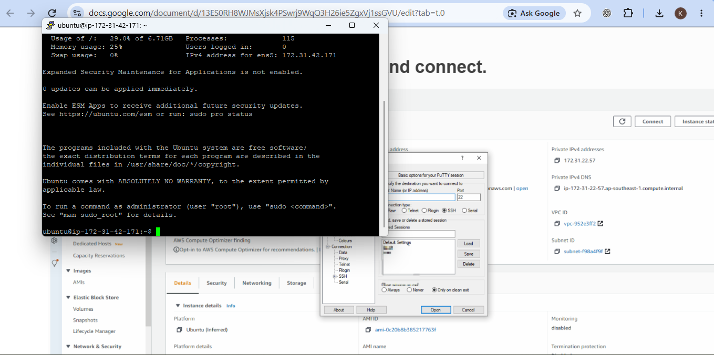
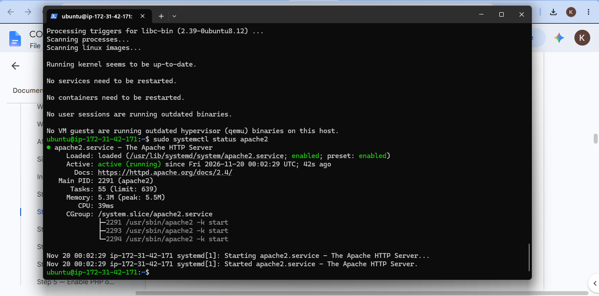
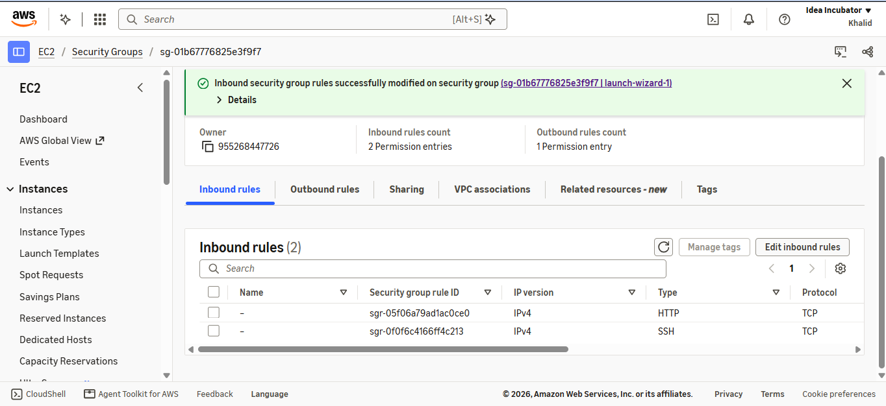
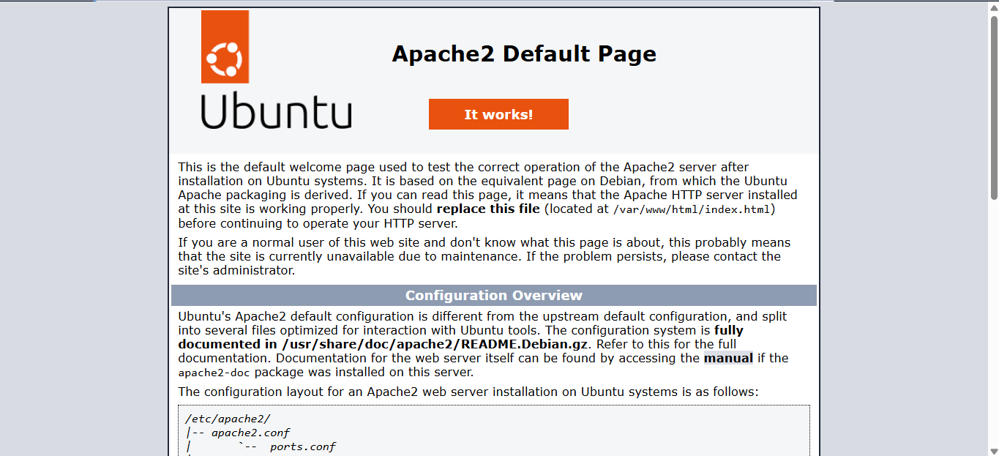
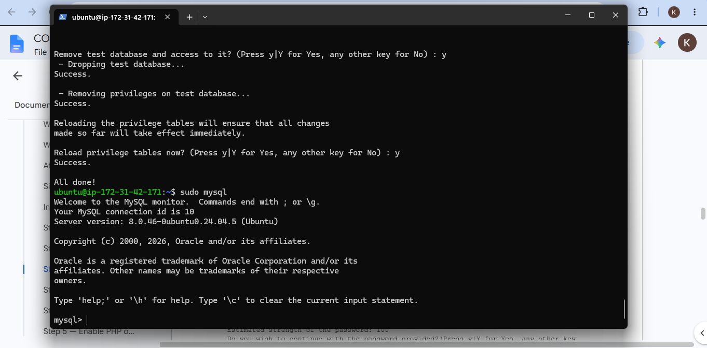
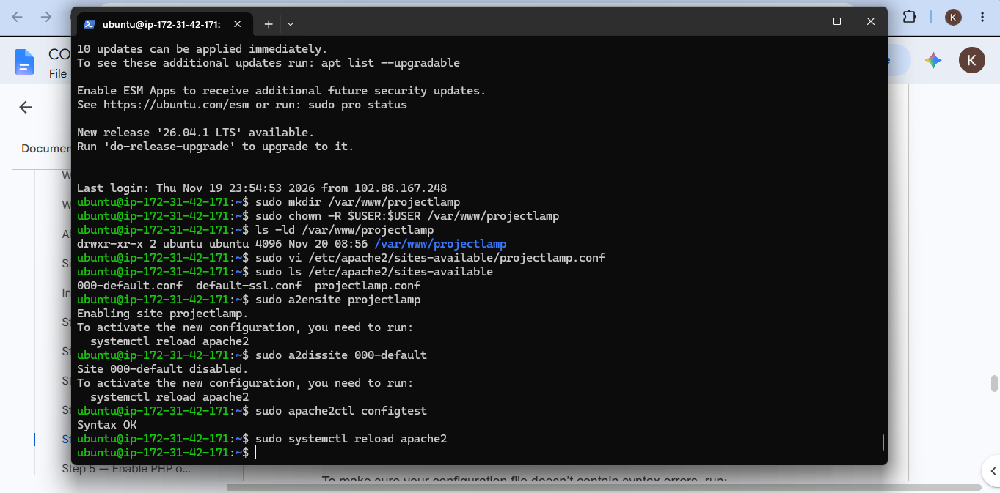
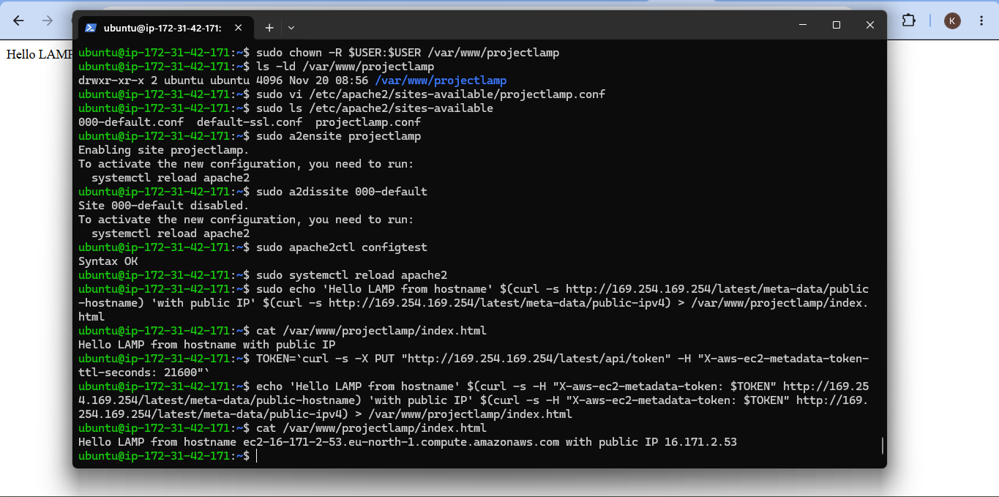
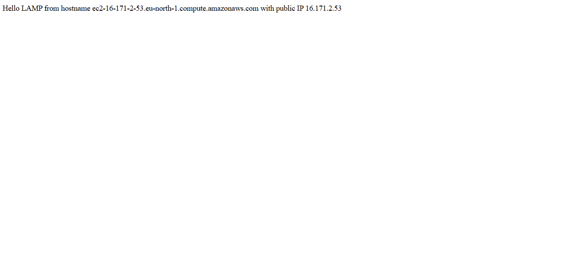
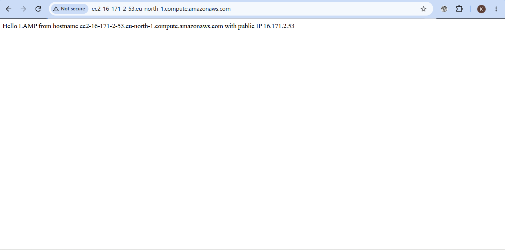
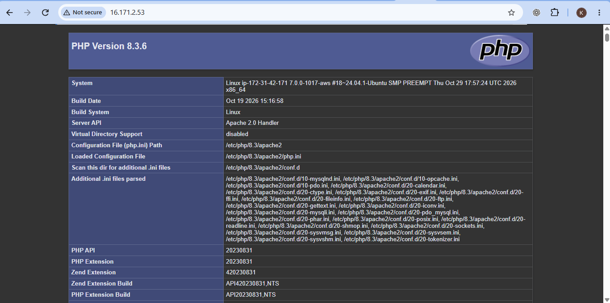

# LAMP-STACK-Task1

In this project, I set up a website server on AWS using LAMP (Linux, Apache, MySQL, PHP).

## Step 0 – Create the Server

I created an Ubuntu server on AWS and logged in to it.



## Step 1 – Install Apache

Apache is the web server. It shows websites to visitors.

```bash
sudo apt update
sudo apt install apache2
sudo systemctl status apache2
```



I opened port 80 so people can visit the website.



The Apache page opened in my browser.



## Step 2 – Install MySQL

MySQL is the database. It stores data.

```bash
sudo apt install mysql-server
sudo mysql_secure_installation
sudo mysql
```



## Step 3 – Install PHP

PHP runs the website code.

```bash
sudo apt install php libapache2-mod-php php-mysql
php -v
```

## Step 4 – Create My Website Folder

I made a folder for my website and told Apache to use it.

```bash
sudo mkdir /var/www/projectlamp
sudo chown -R $USER:$USER /var/www/projectlamp
sudo vi /etc/apache2/sites-available/projectlamp.conf
sudo a2ensite projectlamp
sudo a2dissite 000-default
sudo apache2ctl configtest
sudo systemctl reload apache2
```



I added a simple test page.



My website opened with the IP address and with the web address.





## Step 5 – Test PHP

I made a PHP test page to check that PHP works.

```php
<?php
phpinfo();
```



Then I deleted the test page to keep the server safe.

## What I Learned

- How to create a server on AWS
- How to install Apache, MySQL and PHP
- How to open a port
- How to set up my own website folder
